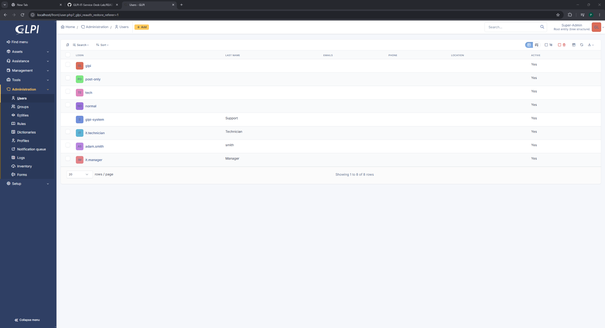
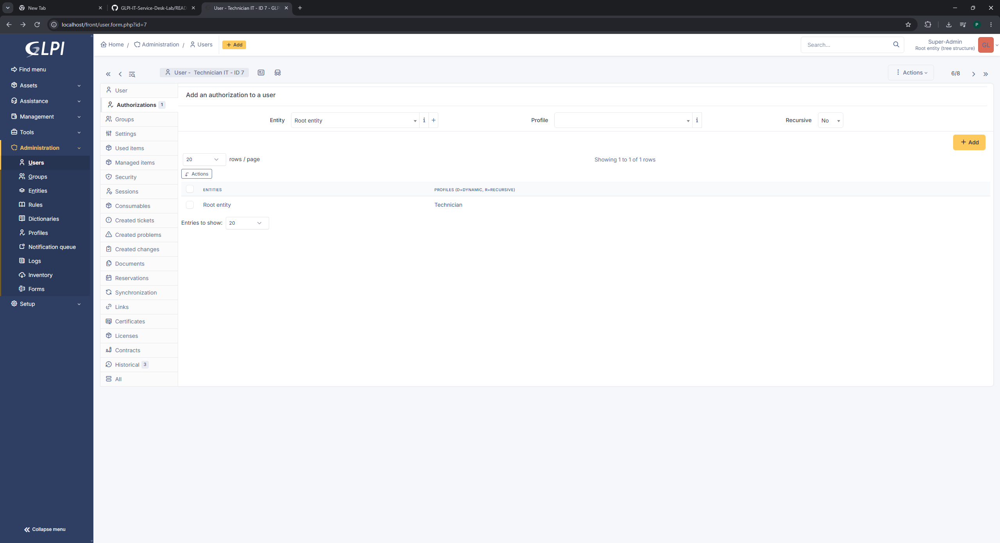
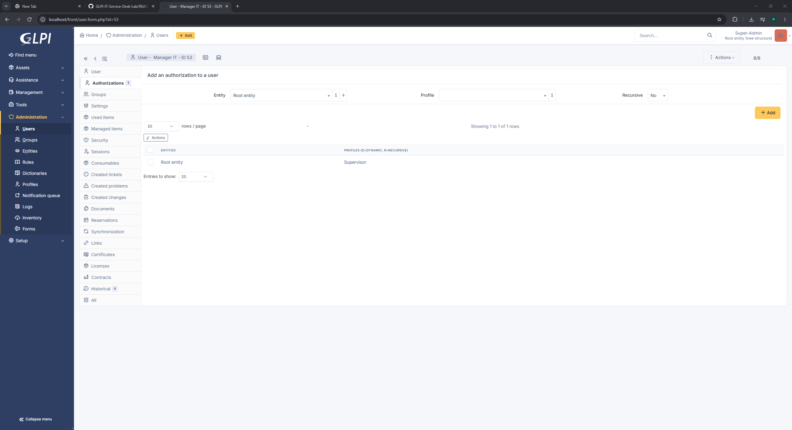
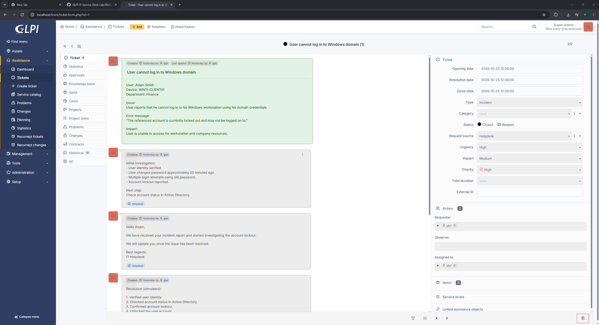
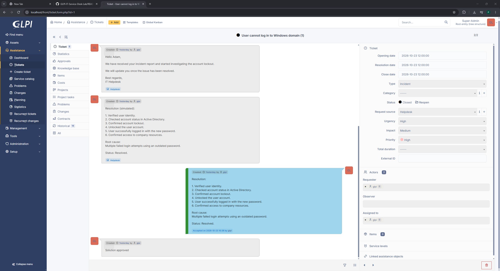
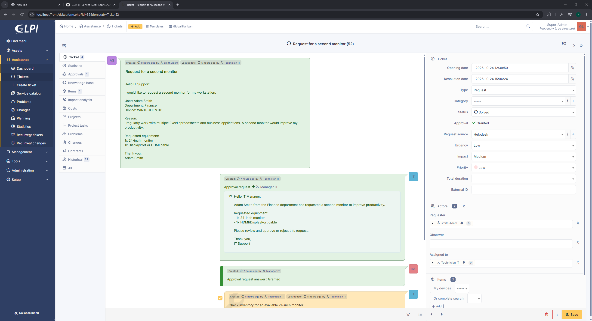
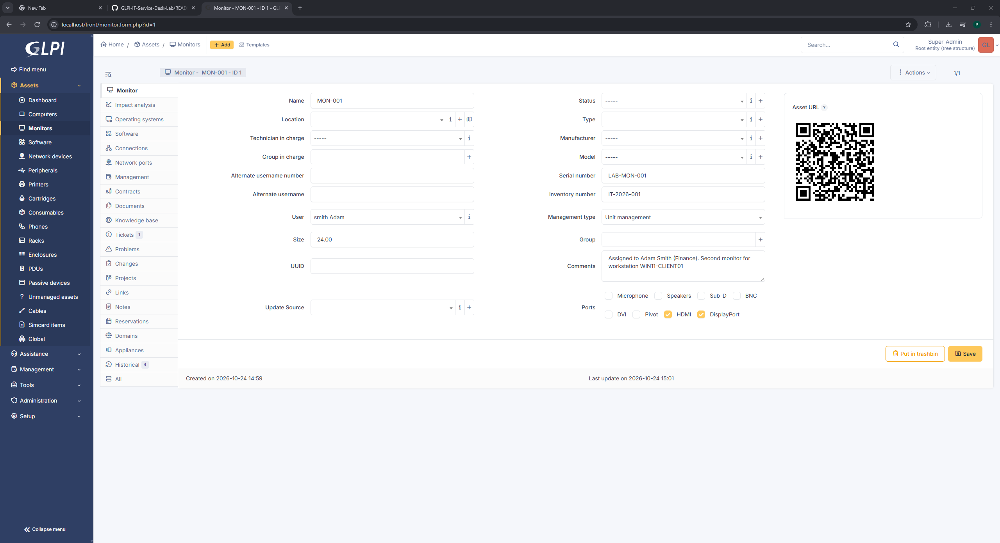
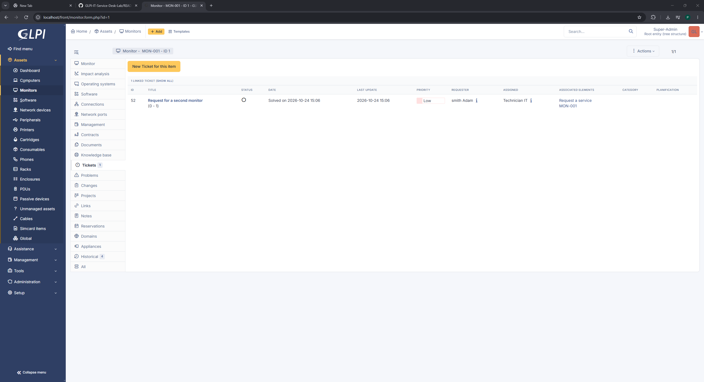
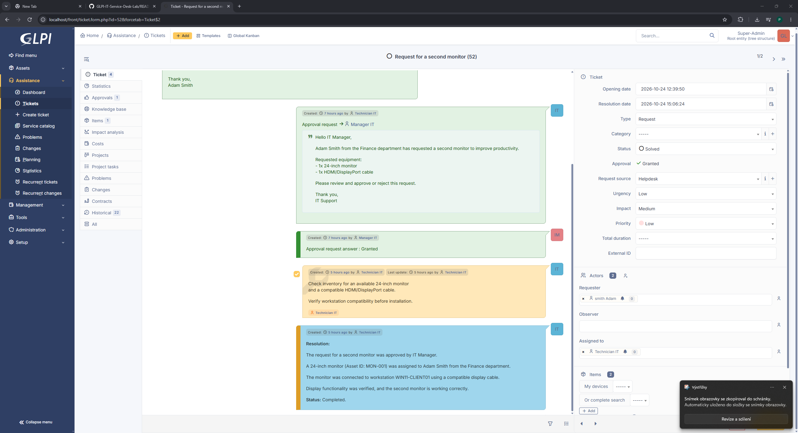
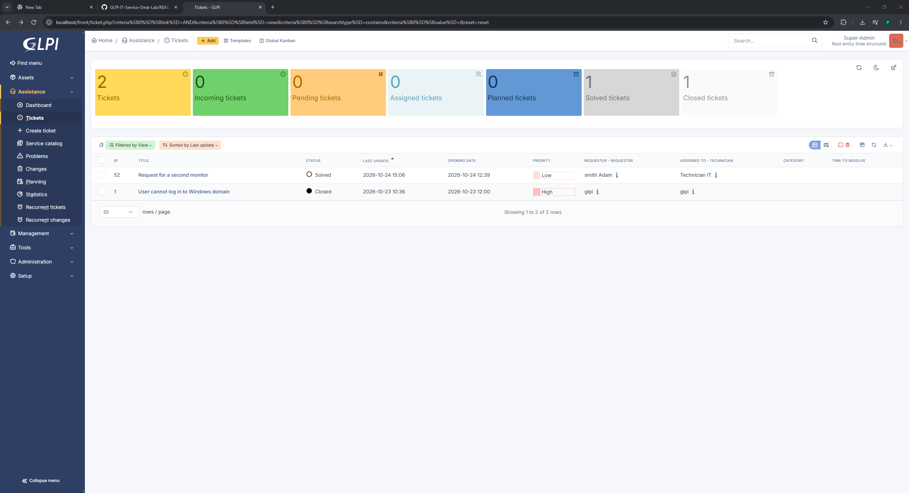

# GLPI IT Service Desk Lab

## Project Overview

This project demonstrates a simulated corporate IT Service Desk environment built using **GLPI** and **Docker Desktop**.

The objective was to gain hands-on experience with **L1/L2 IT Support workflows**, including:

- User account and role management
- Incident and service request management
- Troubleshooting documentation
- Manager approval workflows
- Technician task management
- IT asset inventory and assignment
- Ticket resolution and closure

All scenarios were performed in a personal training environment.

## Technologies Used

- GLPI (IT Service Management)
- Docker Desktop
- Docker Compose
- MySQL
- Windows 11
- PowerShell

## Lab Environment

GLPI was deployed locally using Docker Compose.

The environment consists of:

- GLPI application container
- MySQL database container
- Persistent Docker volumes
- Web interface accessible at `http://localhost`

## 1. User Account Configuration

Three user accounts were configured to simulate different responsibilities within an IT department.

| Account | GLPI Profile | Responsibility |
|---|---|---|
| Technician IT | Technician | Processes tickets and manages IT assets |
| Manager IT | Supervisor | Reviews and approves requests |
| Adam Smith | Self-Service | Submits IT support requests |

### User Accounts

### Technician Permissions

### Manager Permissions

### End User Permissions

## 2. Incident Management: Windows Domain Login Failure

**Ticket #1: User cannot log in to Windows domain**

**Type:** Incident  
**Priority:** High  
**Affected user:** Adam Smith  
**Workstation:** WIN11-CLIENT01

### Problem Description

The user reported being unable to sign in to a Windows workstation using domain credentials.

The reported error was:

> The referenced account is currently locked out and may not be logged on to.

### Investigation

The simulated troubleshooting process included:

1. Verifying the user's identity.
2. Gathering information about recent password changes.
3. Identifying repeated login attempts with an outdated password.
4. Checking the reported account lockout scenario.
5. Documenting the investigation in GLPI.

### Incident Documentation

### Resolution

A simulated resolution was documented, covering account unlock, successful sign-in with the updated password, and verification of access to company resources.

**Root cause:** Multiple failed login attempts using an outdated password.

**Final status:** Closed

## 3. Service Request: Second Monitor

**Ticket #52: Request for a second monitor**

**Type:** Service Request  
**Priority:** Low  
**Requester:** Adam Smith  
**Department:** Finance  
**Workstation:** WIN11-CLIENT01

### Request Description

An employee requested a second monitor to improve productivity while working with Excel spreadsheets and business applications.

Requested equipment:

- One 24-inch monitor
- Compatible HDMI or DisplayPort cable

### Manager Approval

The IT Technician submitted the equipment request to the IT Manager for approval.

The manager reviewed the request and granted approval using GLPI's built-in approval workflow.

### Technician Task

A technician task was created to:

1. Check monitor availability in inventory.
2. Verify display connection compatibility.
3. Prepare the monitor for assignment.

### IT Asset Management

A monitor was registered in GLPI and assigned to Adam Smith.

| Property | Value |
|---|---|
| Asset Name | MON-001 |
| Screen Size | 24 inches |
| Serial Number | LAB-MON-001 |
| Inventory Number | IT-2026-001 |
| Assigned User | Adam Smith |
| Workstation | WIN11-CLIENT01 |
| Connections | HDMI / DisplayPort |

### Asset and Ticket Linking

The monitor asset was linked to ticket #52, providing traceability between the employee's request and the assigned equipment.

### Service Request Resolution

The simulated resolution documents:

- Manager approval received
- Monitor assigned to the employee
- Monitor connected to the workstation
- Display functionality verified
- Service request marked as resolved

**Final status:** Solved

## 4. Ticket Overview

The GLPI ticket dashboard was used to monitor incident and service request statuses.

## Skills Demonstrated

- IT Service Management (ITSM)
- L1/L2 Helpdesk workflows
- Incident management
- Service request management
- Troubleshooting and root cause documentation
- Role-based access control (RBAC)
- Approval workflows
- IT asset management
- Asset-to-ticket relationships
- Technical documentation
- Docker-based application deployment

## Key Takeaways

This lab provided practical experience with managing IT support workflows in GLPI.

It helped demonstrate the differences between **incidents** and **service requests**, how requests move through approval processes, and how IT assets can be tracked and associated with support tickets.

The project also reinforced the importance of documenting troubleshooting steps, maintaining clear ticket histories, and assigning appropriate permissions to different user roles.

---

**Disclaimer:** This project was completed in a personal training lab. All users, devices, assets, and support scenarios are simulated. The documented incident and equipment installation are simulated workflows, not verified production changes.
